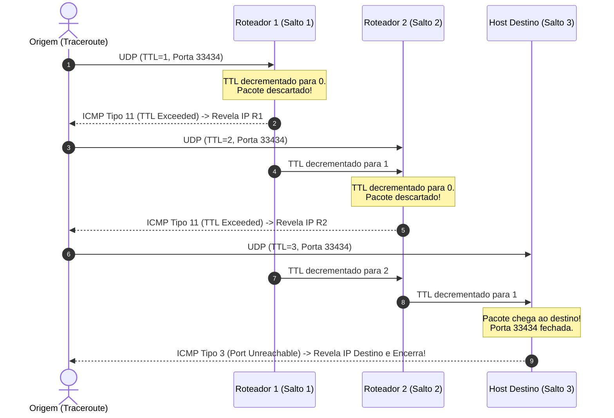

# Projeto 1: Implementação de Traceroute em Baixo Nível

> **Disciplina:** Redes de Computadores  
> **Linguagem:** Python 3 (sem bibliotecas externas)  
> **Avaliação:** 10/10 Testes Locais Aprovados (Nota 10.0 / 100%)

---

## 1. Visão Geral do Projeto

Este projeto consiste na implementação completa em baixo nível do utilitário de diagnóstico de rede **Traceroute**. O objetivo é rastrear e mapear o caminho de roteadores intermediários (*hops*) percorridos pelos pacotes desde o computador de origem até um determinado destino final na Internet.

A implementação trata diretamente da manipulação de **bytes crus** de datagramas de rede, realizando a decodificação (*parsing*) de cabeçalhos de protocolos das camadas de Internet e Transporte (**IPv4**, **ICMP** e **UDP**), gerenciamento de tempo de vida dos pacotes (**TTL**) e tratamento de respostas de controle assíncronas.

---

## 2. Fundamentos Teóricos de Redes

Para compreender o funcionamento do Traceroute e defender as decisões de implementação na apresentação técnica, os seguintes conceitos fundamentais são aplicados:

### 2.1. O Mecanismo do TTL (*Time-To-Live*)
* No protocolo **IPv4**, o campo TTL (8 bits) define o número máximo de saltos (*hops*) que um pacote pode percorrer antes de ser descartado.
* Cada roteador intermediário que recebe o pacote decrementa o campo TTL em $1$ unidade antes de encaminhá-lo.
* Se o TTL chegar a $0$, o roteador descarta o pacote e envia uma mensagem de erro **ICMP Tempo Excedido** (*Time Exceeded*, Tipo 11, Código 0) de volta para o remetente original.
* **O Truque do Traceroute:** Enviamos sondas intencionalmente com TTLs progressivos ($TTL = 1, 2, 3, \dots$). Assim, forçamos cada roteador ao longo do caminho a descartar o pacote e revelar seu próprio endereço IP no cabeçalho da mensagem de erro ICMP gerada.



---

### 2.2. Detecção de Chegada ao Destino (*Port Unreachable*)
* Como o host de destino final não deve descartar o pacote por expiração de TTL, enviamos datagramas UDP para uma **porta alta improvável** (por padrão `33434`).
* Ao receber o datagrama em uma porta fechada/não utilizada, o sistema operacional do destino responde com uma mensagem **ICMP Destino/Porta Inalcançável** (*Destination Unreachable - Port Unreachable*, Tipo 3, Código 3).
* O recebimento dessa mensagem confirma inequivocamente que o pacote alcançou o host final, servindo como critério de encerramento do Traceroute.

---

### 2.3. Resumo dos Protocolos e Cabeçalhos

```
+-------------------------------------------------------------------------+
|                              CAMADA 3: IPv4                             |
|  0                   1                   2                   3          |
|  0 1 2 3 4 5 6 7 8 9 0 1 2 3 4 5 6 7 8 9 0 1 2 3 4 5 6 7 8 9 0 1        |
| +-+-+-+-+-+-+-+-+-+-+-+-+-+-+-+-+-+-+-+-+-+-+-+-+-+-+-+-+-+-+-+-+       |
| |Version|  IHL  |Type of Service|          Total Length         |       |
| +-+-+-+-+-+-+-+-+-+-+-+-+-+-+-+-+-+-+-+-+-+-+-+-+-+-+-+-+-+-+-+-+       |
| |         Identification        |Flags|      Fragment Offset    |       |
| +-+-+-+-+-+-+-+-+-+-+-+-+-+-+-+-+-+-+-+-+-+-+-+-+-+-+-+-+-+-+-+-+       |
| |  Time to Live |    Protocol   |        Header Checksum        |       |
| +-+-+-+-+-+-+-+-+-+-+-+-+-+-+-+-+-+-+-+-+-+-+-+-+-+-+-+-+-+-+-+-+       |
| |                       Source IP Address                       |       |
| +-+-+-+-+-+-+-+-+-+-+-+-+-+-+-+-+-+-+-+-+-+-+-+-+-+-+-+-+-+-+-+-+       |
| |                    Destination IP Address                     |       |
| +-+-+-+-+-+-+-+-+-+-+-+-+-+-+-+-+-+-+-+-+-+-+-+-+-+-+-+-+-+-+-+-+       |
| |                    Options (se IHL > 5) ...                   |       |
| +---------------------------------------------------------------+       |
|                                                                         |
|        CAMADA 4: ICMP (Proto=1)      ou       CAMADA 4: UDP (Proto=17)  |
| +-+-+-+-+-+-+-+-+-+-+-+-+-+-+-+-+    +-+-+-+-+-+-+-+-+-+-+-+-+-+-+-+-+  |
| |  Type |  Code |    Checksum   |    |  Source Port  | Destination P |  |
| +-+-+-+-+-+-+-+-+-+-+-+-+-+-+-+-+    +-+-+-+-+-+-+-+-+-+-+-+-+-+-+-+-+  |
| |     Unused / Header Rest      |    |     Length    |    Checksum   |  |
| +-+-+-+-+-+-+-+-+-+-+-+-+-+-+-+-+    +-+-+-+-+-+-+-+-+-+-+-+-+-+-+-+-+  |
| | Payload (IP original + 8 B)   |    | Payload de Dados              |  |
| +-+-+-+-+-+-+-+-+-+-+-+-+-+-+-+-+    +-+-+-+-+-+-+-+-+-+-+-+-+-+-+-+-+  |
+-------------------------------------------------------------------------+
```

---

## 3. Estrutura do Código e Implementação

O código-fonte principal está contido em `traceroute.py`. Abaixo estão os detalhes técnicos de cada componente implementado:

### 3.1. Parsing dos Cabeçalhos Binários

#### Classe `IPv4`
Realiza a decodificação dos campos do cabeçalho IP a partir de um `buffer: bytes`:
* **`version`**: Extraído dos 4 bits superiores do primeiro byte: `(buffer[0] >> 4) & 0x0F` (resultado: 4).
* **`header_len`**: Comprimento do cabeçalho em bytes. O campo IHL (Internet Header Length) ocupa os 4 bits inferiores do primeiro byte e expressa o tamanho em palavras de 32 bits (4 bytes). Portanto: `(buffer[0] & 0x0F) * 4`.
* **`tos`**: Byte 1 (`buffer[1]`).
* **`length`**: Bytes 2 e 3 convertidos de *Network Byte Order* (*big-endian*): `int.from_bytes(buffer[2:4], "big")`.
* **`id`**: Bytes 4 e 5: `int.from_bytes(buffer[4:6], "big")`.
* **`flags` e `frag_offset`**: Os bytes 6 e 7 contêm conjuntamente 3 bits de flags e 13 bits de offset:
  * `flags_offset = int.from_bytes(buffer[6:8], "big")`
  * `flags = (flags_offset >> 13) & 0x07`
  * `frag_offset = flags_offset & 0x1FFF`
* **`ttl`**: Byte 8 (`buffer[8]`).
* **`proto`**: Byte 9 (`buffer[9]`, onde 1 = ICMP, 17 = UDP).
* **`cksum`**: Bytes 10 e 11 (`int.from_bytes(buffer[10:12], "big")`).
* **`src` e `dst`**: Bytes 12..15 e 16..19 formatados em notação decimal pontuada (`f"{buffer[12]}.{buffer[13]}.{buffer[14]}.{buffer[15]}"`).

#### Classe `ICMP`
* **`type`**: Byte 0 (`buffer[0]`).
* **`code`**: Byte 1 (`buffer[1]`).
* **`cksum`**: Bytes 2 e 3 (`int.from_bytes(buffer[2:4], "big")`).

#### Classe `UDP`
* **`src_port`**: Bytes 0 e 1 (`int.from_bytes(buffer[0:2], "big")`).
* **`dst_port`**: Bytes 2 e 3 (`int.from_bytes(buffer[2:4], "big")`).
* **`len`**: Bytes 4 e 5 (`int.from_bytes(buffer[4:6], "big")`).
* **`cksum`**: Bytes 6 e 7 (`int.from_bytes(buffer[6:8], "big")`).

---

### 3.2. Funções Auxiliares Modulares

Conforme as diretrizes de projeto da disciplina:

1. **`classificar_resposta_icmp(icmp: ICMP) -> str`**
   * Retorna `"tempo_excedido"` se `icmp.type == 11` (ICMP Time Exceeded).
   * Retorna `"porta_inalcancavel"` se `icmp.type == 3` (ICMP Destination/Port Unreachable).
   * Retorna `"ignorar"` para qualquer outro tipo.

2. **`calcular_inicio_cabecalho_transporte(buffer: bytes) -> int`**
   * Retorna em bytes o deslocamento onde termina o cabeçalho IPv4 e inicia o cabeçalho encapsulado (`(buffer[0] & 0x0F) * 4`), garantindo suporte correto a pacotes com opções IP de tamanho variável.

3. **`deve_encerrar_traceroute(ip_origem: str, ip_destino: str, icmp: ICMP) -> bool`**
   * Avalia se a resposta atual veio do destino final (`ip_origem == ip_destino` ou resposta `"porta_inalcancavel"`), sinalizando a conclusão do rastreamento.

4. **`registrar_roteador_descoberto(roteadores_ttl: list[str], endereco: str) -> None`**
   * Mantém a unicidade dos roteadores descobertos em um mesmo salto (TTL), evitando inserção de endereços duplicados decorrentes de múltiplas sondas no mesmo nível.

5. **`interpretar_resposta_da_sonda(buffer: bytes) -> tuple[IPv4, ICMP | None]`**
   * Encapsula a lógica de extração do pacote externo: cria a instância de `IPv4` e, se o protocolo for ICMP, extrai a fatia do buffer correspondente e instancia o objeto `ICMP`.

---

### 3.3. Algoritmo Principal `traceroute()`

```python
def traceroute(sendsock: util.Socket, recvsock: util.Socket, ip: str) -> list[list[str]]:
```

1. Itera o `ttl` de $1$ até `TRACEROUTE_MAX_TTL` ($30$).
2. Configura o TTL do socket emissor: `sendsock.set_ttl(ttl)`.
3. Para cada nível de TTL, envia `PROBE_ATTEMPT_COUNT` ($3$) sondas UDP para `(ip, 33434)`.
4. Utiliza `recvsock.recv_select()` para verificar se há resposta ICMP sem bloquear indefinidamente a execução.
5. Em caso de resposta, interpreta o cabeçalho e classifica a mensagem ICMP:
   * Registra o IP do respondedor na lista do TTL atual via `registrar_roteador_descoberto()`.
   * Verifica se o destino foi alcançado via `deve_encerrar_traceroute()`.
6. Imprime o resultado do salto formatado via `util.print_result(roteadores_ttl, ttl)`.
7. Interrompe as iterações imediatamente caso o destino tenha sido alcançado, retornando a lista de saltos.

---

## 4. Estrutura de Arquivos do Projeto

| Arquivo | Descrição |
| :--- | :--- |
| `traceroute.py` | **Arquivo de entrega.** Contém os parsers de pacotes e o algoritmo de traceroute. |
| `util.py` | Funções utilitárias fornecidas (sockets, conversão de endereços, impressão formatada). |
| `simulador_rede.py` | Simulador determinístico em memória para testes locais sem necessidade de privilégios de root. |
| `cenarios_teste.py` | Cenários de depuração de rede com topologias lineares, múltiplos caminhos e saltos com perda de pacote. |
| `testes.py` | Suíte com 10 testes unitários automatizados cobrindo parsing e traceroute. |
| `avaliar.py` | Script oficial de avaliação técnica que calcula a nota final (0.0 a 10.0). |

---

## 5. Como Executar e Validar

### 5.1. Execução da Avaliação Oficial (10 Testes)

```bash
python avaliar.py
```

**Saída esperada:**
```text
test_01_ipv4_basico (testes.TestesProjeto1.test_01_ipv4_basico) ... ok
test_02_ipv4_com_opcoes (testes.TestesProjeto1.test_02_ipv4_com_opcoes) ... ok
test_03_ipv4_campos_variados (testes.TestesProjeto1.test_03_ipv4_campos_variados) ... ok
test_04_icmp (testes.TestesProjeto1.test_04_icmp) ... ok
test_05_udp (testes.TestesProjeto1.test_05_udp) ... ok
test_06_traceroute_linear (testes.TestesProjeto1.test_06_traceroute_linear) ... ok
test_07_traceroute_multiplos_caminhos (testes.TestesProjeto1.test_07_traceroute_multiplos_caminhos) ... ok
test_08_traceroute_salto_sem_resposta (testes.TestesProjeto1.test_08_traceroute_salto_sem_resposta) ... ok
test_09_traceroute_remove_duplicatas (testes.TestesProjeto1.test_09_traceroute_remove_duplicatas) ... ok
test_10_para_ao_encontrar_destino_e_imprime_por_ttl (testes.TestesProjeto1.test_10_para_ao_encontrar_destino_e_imprime_por_ttl) ... ok

----------------------------------------------------------------------
Ran 10 tests in 0.006s

OK

=== RESULTADO DA AVALIACAO LOCAL ===
Testes aprovados: 10/10
Percentual: 100%
Nota correspondente (escala 0-10): 10.0
A nota deve ser validada na apresentacao ao professor.
```

### 5.2. Execução dos Cenários de Depuração

```bash
python cenarios_teste.py
```

**Saída esperada:**
```text
=== caminho_linear ===
 1: 10.0.0.1
 2: 10.0.0.2
 3: 10.0.0.3
 4: 10.0.0.4
Esperado: [['10.0.0.1'], ['10.0.0.2'], ['10.0.0.3'], ['10.0.0.4']]
Obtido:   [['10.0.0.1'], ['10.0.0.2'], ['10.0.0.3'], ['10.0.0.4']]
Resultado: OK

=== multiplos_caminhos ===
 1: 10.0.0.1
 2: 10.0.0.2, 10.0.0.4
 3: 10.0.0.3, 10.0.0.5
 4: 10.0.0.6
 5: 10.0.0.7
Esperado: [['10.0.0.1'], ['10.0.0.2', '10.0.0.4'], ['10.0.0.3', '10.0.0.5'], ['10.0.0.6'], ['10.0.0.7']]
Obtido:   [['10.0.0.1'], ['10.0.0.2', '10.0.0.4'], ['10.0.0.3', '10.0.0.5'], ['10.0.0.6'], ['10.0.0.7']]
Resultado: OK

=== salto_sem_resposta ===
 1: 10.0.1.1
 2: *
 3: 10.0.1.3
 4: 10.0.1.4
Esperado: [['10.0.1.1'], [], ['10.0.1.3'], ['10.0.1.4']]
Obtido:   [['10.0.1.1'], [], ['10.0.1.3'], ['10.0.1.4']]
Resultado: OK

Cenarios corretos: 3/3
```

---

## 6. Guia para Apresentação ao Professor

Durante a apresentação do projeto, o professor normalmente avalia a compreensão dos conceitos teóricos e a implementação em código. Abaixo estão as perguntas clássicas e respostas objetivas:

### Pergunta 1: *"Por que enviamos pacotes UDP em vez de pacotes ICMP Echo Request (Ping)?"*
> **Resposta:** O traceroute clássico envia datagramas UDP para portas altas fechadas (como 33434) para que os roteadores intermediários respondam com *ICMP Time Exceeded* (Tipo 11), e o host de destino responda especificamente com *ICMP Port Unreachable* (Tipo 3, Código 3). Isso permite diferenciar de forma clara e determinística quando chegamos a um roteador intermediário e quando alcançamos o host final.

### Pergunta 2: *"Como calculamos o início do cabeçalho de transporte no IPv4?"*
> **Resposta:** O campo IHL (Internet Header Length) está nos 4 bits menos significativos do primeiro byte do cabeçalho IPv4 (`buffer[0] & 0x0F`). Ele expressa o tamanho em palavras de 32 bits (4 bytes). Multiplicamos por 4 para obter o tamanho em bytes (`header_len = IHL * 4`). O cabeçalho de transporte (ICMP/UDP) começa exatamente no deslocamento `buffer[header_len:]`. Isso garante que pacotes com opções IP variáveis sejam tratados corretamente.

### Pergunta 3: *"Por que enviamos 3 sondas por salto (TTL) em vez de apenas 1?"*
> **Resposta:** Por duas razões:
> 1. **Tolerância a Perdas:** A Internet opera em modelo *best-effort*, e pacotes UDP ou respostas ICMP podem ser descartados por congestionamento.
> 2. **Descoberta de Múltiplos Caminhos (ECMP):** Em redes com balanceamento de carga, pacotes com o mesmo TTL podem percorrer enlaces diferentes e alcançar roteadores alternativos na mesma distância em saltos.

### Pergunta 4: *"Como tratamos saltos que não respondem (linhas com asterisco `*`)?"*
> **Resposta:** Se nenhuma resposta ICMP for recebida dentro da janela de `select` para nenhuma das sondas daquele TTL, a lista do respectivo salto fica vazia (`[]`). A função `util.print_result` imprime `*`, e o algoritmo avança para o próximo TTL até atingir o limite `TRACEROUTE_MAX_TTL`.
